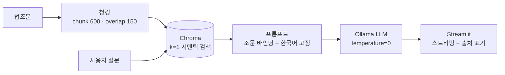

# 클라우드 없이, 16GB 노트북에서 돌아가는 한국어 법률 RAG 챗봇 만들기

- *"이 질문, 사내 데이터를 OpenAI에 보내도 되나요?"* — 사내 법률·규정 문서에 대해 GPT API로 답변해주는 챗봇
- **외부 API 없이, CPU 전용 16GB 환경에서 동작하는 온프레미스 법률 RAG**를 PoC로 완성

```
🙋 개인정보를 수집할 때 상대방에게 고지해야 하는 항목들을 알려주세요.

🤖 개인정보보호 수집·이용 대상 항목
1. 개인정보의 수집·이용 목적
2. 수집하려는 개인정보의 항목
3. 개인정보의 보유 및 이용 기간

📌 [근거 조문 출처] 제15조(개인정보의 수집·이용) ① 개인정보처리자는 다음 각 호의 어느 하...
```

---

## 왜 "완전 로컬"인가

법률·인사 문서는 대표적인 **민감정보**입니다. 임직원 정보가 들어간 규정이나 사내 계약서를 클라우드 LLM에 넘기는 순간, 컴플라이언스 검토부터 시작해야 하죠. 그래서 설계의 축을 세 가지로 잡았습니다.

1. **질문과 문서가 절대 네트워크를 나가지 않을 것** — Ollama로 LLM 추론, 임베딩, 벡터 저장까지 전부 온프레미스로 구성
2. **GPU 없는 평범한 회사 노트북에서 돌아갈 것** — 자연스럽게 7~9B급 SLM만 후보로 남음
3. **답변이 "지어낸 게 아니라 근거 기반"임을 증명할 것** — 검색된 조문을 프롬프트에 바인딩하고, 답변 하단에 출처 표기를 강제

## 스택 선택 — "가성비"가 전부

| 레이어 | 선택 | 이유 |
|---|---|---|
| LLM | Ollama + `qwen2.5:7b` / `gemma2:9b` | 16GB RAM CPU에서 실제로 답변이 가능한 최고 품질 SLM |
| 임베딩 | `jhgan/ko-sbert-nli` (CPU) | 한국어 문맥 이해 품질 대비 메모리 점유 극소 |
| 벡터 DB | Chroma (임베디드) | 별도 DB 프로세스 없이 Python에서 바로 |
| 오케스트레이션 | LangChain | 청킹/검색/프롬프트 조립 |
| UI | Streamlit | 채팅 UI + 스트리밍을 몇십 줄로 |

전부 **"엔터프라이즈급 최선"이 아니라 "이 하드웨어에서 돌아가는 최선"**을 고른 조합입니다.

## 파이프라인 구성



설계에서 실제로 고민했던 두 가지를 짚어보면:

### 1) 청킹에서 "조문 경계"를 어떻게 지키나

법조문은 `제15조 ① ... ② ...` 식의 **계층 참조 구조**입니다. 이게 일반 청킹으로 잘리면 아래처럼 파손됩니다.

> "…② 개인정보처리자는 제1항제1호에 따른 동의를…" — **항 번호가 앞 문맥과 끊긴 조각**

LLM은 이 조각을 독립적 규범처럼 해석하고, 질문-조문 매칭이 흔들립니다. 해결은 `chunk_size=600 / overlap=150`으로 **조문 1개가 온전히 담기는 크기**를 목표로 잡는 것이었습니다. 청킹은 사람이 읽는 쪽이 아니라 **모델이 읽어야 하는 컨텍스트 설계**라는 걸 이번에 제대로 느꼈습니다.

### 2) temperature=0 — 법률 QA에서 창의성은 버그다

법률 질문에는 "창의적인 대안"이 아니라 **"문서에 그대로 있는 답"**이 필요합니다. `temperature=0` + 조문 바인딩 프롬프트 + 출처 표기 3종 세트로 환각을 억제했습니다.

## 가장 재미있었던 트러블슈팅 — 답변이 중국어로 튀는 문제

노트북에서는 완벽했는데, Streamlit 앱으로 서빙하니 갑자기 답변의 일부가 **중국어/영어**로 나오기 시작했습니다. 같은 모델인데 프롬프트는 거의 동일했죠.

원인을 보니: 소형 LLM은 출력 초반 몇 토큰에 **다국어 분포가 흔들리는 구간**이 있는데, Qwen은 훈련 데이터상 중국어 비중이 높은 편이라, 서빙 맥락(UX 요소가 섞인 입력 등)의 작은 트리거에 언어 전환이 일어나는 것이었습니다.

해결은 의외로 프리미티브했습니다 — system 프롬프트에 한 줄 추가:

```python
"답변은 한국어로 해야 합니다. 답변 전체를 영어나 중국어로 하는 것은 금지됩니다."
```

그리고 실험 단계의 모델(Gemma2 9B)과 최종 서빙 모델(Qwen2.5 7B)의 언어 안정성을 각각 확인하고 앱 기준으로 확정했습니다. **실험 환경과 서빙 환경의 동작을 같다고 가정하면 안 된다**는 교훈이었습니다.

이런 계열 트러블이 총 9건 있었습니다. 초경량 `deepseek-r1:1.5b`의 한국어 품질 부족으로 모델을 교체했던 것, Streamlit이 리렌더링마다 모델을 재로딩하는 문제를 `@st.cache_resource`로 잡은 것 등입니다. 전체 기록은 프로젝트의 `TROUBLES.md`에 남겨두었습니다.

## UI 실행 화면


- 질문마다 검색된 조문 하나(k=1)만 프롬프트에 주입
- CPU 추론의 체감 지연을 **스트리밍**(커서 `▌`)으로 완화
- 답변 하단에 **📌 근거 조문 출처** 고정 표기 — "이 답변이 어느 조문에서 나왔는지"를 사용자가 바로 검증 가능

## 짧은 회고

**잘 된 것**

- "반드시 온프레미스"라는 제약을 먼저 두자, 보안·비용 관점이 자연스럽게 깨끗해짐
- k=1, temperature=0, 출처 표기라는 3가지 장치만으로도 7B급 모델에서 신뢰할 만한 품질 도달
- 스트리밍 한 줄이 CPU 환경의 "답답함"을 대부분 상쇄

**아쉬운 것**

- k=1 회수는 "질문이 두 조문에 걸친 경우" 정밀도가 떨어짐 → Top-K + 출처 카드 병렬 표기로 개선 필요
- 조문이 코드에 하드코딩된 형태 → PDF/XML 파싱 파이프라인으로 **실제 법령 전문** 확장 필요
- 인젝션 방어가 없음 — 법률 외 질문도 조문을 억지로 근거 삼아 답변하는 경향 있음

## 다음 단계

이번 PoC는 "손으로 넣은 조문 몇 개"였지만, 실제 서비스를 위해서는 데이터 파이프라인이 앞에 필요합니다.

1. **실제 법령·사내 문서 인덱싱** — 법제처 공동활용(XML/Json) 또는 PDF → 조문 경계 분할 → Chroma 영속 DB. 사내 폴더의 PDF/TXT라면 형식별 파서 + 내용 해시 기반 **증분 색인**
2. **가드레일** — NeMo Guardrails 등으로 법률 외 주제·프롬프트 인젝션 사전 차단

---

사내 데이터를 외부로 꺼내지 않고도 챗봇을 만들 수 있습니다. 필요한 건 대형 GPU가 아니라, **청킹·프롬프트 같은 구조를 데이터 특성에 맞게 정성스럽게 만들어 주는 것**이라는 걸 이번 PoC에서 배웠습니다.

관심 있으신 분은 프로젝트의 `README.md`(실행법)와 `TROUBLES.md`(트러블슈팅 전체 기록)를 참고해 주세요. 궁금한 점은 댓글로 남겨주시면 감사하겠습니다. 🙏
