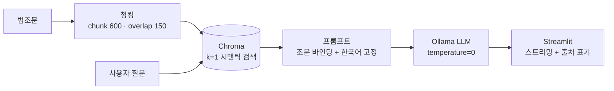

# 16GB 노트북에서 돌아가는 한국어 법률 RAG 챗봇 만들기

- *"이 질문, 사내 데이터를 OpenAI에 보내도 되나요?"* — 사내 법률·규정 문서에 대해 GPT API로 답변해주는 챗봇
- **CPU 전용 16GB 환경에서 동작하는 온프레미스 법률 RAG**를 PoC로 완성

```
🙋 개인정보를 수집할 때 상대방에게 고지해야 하는 항목들을 알려주세요.

🤖 개인정보보호 수집·이용 대상 항목
1. 개인정보의 수집·이용 목적
2. 수집하려는 개인정보의 항목
3. 개인정보의 보유 및 이용 기간

📌 [근거 조문 출처] 제15조(개인정보의 수집·이용) ① 개인정보처리자는 다음 각 호의 어느 하...
```


---

## 로컬로 작업

- 법률·인사 문서는 대표적인 민감정보
- 임직원 정보가 들어간 규정이나 사내 계약서를 클라우드 LLM에 넘기는 순간, 컴플라이언스 검토부터 시작해야 함.

1. **질문과 문서가 절대 네트워크를 나가지 않을 것** — Ollama로 LLM 추론, 임베딩, 벡터 저장까지 전부 온프레미스로 구성
2. **GPU 없는 평범한 회사 노트북에서 돌아갈 것** — 자연스럽게 7~9B급 SLM만 후보로 남음
3. **답변이 "지어낸 게 아니라 근거 기반"임을 증명할 것** — 검색된 조문을 프롬프트에 바인딩하고, 답변 하단에 출처 표기를 강제

## 스택 선택 — "가성비"가 전부

| 레이어 | 선택 | 이유 |
|---|---|---|
| LLM | Ollama + `qwen2.5:7b` / `gemma2:9b` | 16GB RAM CPU에서 실제로 답변이 가능한 최고 품질 SLM |
| 임베딩 | `jhgan/ko-sbert-nli` (CPU) | 한국어 문맥 이해 품질 대비 메모리 점유 극소 |
| 벡터 DB | Chroma (임베디드) | 별도 DB 프로세스 없이 Python에서 바로 |
| 오케스트레이션 | LangChain | 청킹/검색/프롬프트 조립 |
| UI | Streamlit | 채팅 UI + 스트리밍을 몇십 줄로 |

전부 **"엔터프라이즈급 최선"이 아니라 "이 하드웨어에서 돌아가는 최선"**을 고른 조합

## 파이프라인 구성



설계에서 실제로 고민했던 두 가지를 짚어보면:

### 1) 청킹에서 "조문 경계"를 어떻게 지키나

- 법조문은 `제15조 ① ... ② ...` 식의 **계층 참조 구조**
- 일반 청킹으로 잘리면 아래처럼 파손

> "…② 개인정보처리자는 제1항제1호에 따른 동의를…" — **항 번호가 앞 문맥과 끊긴 조각**

- LLM은 이 조각을 독립적 규범처럼 해석하고, 질문-조문 매칭이 흔들립니다.
- 해결은 `chunk_size=600 / overlap=150`으로 **조문 1개가 온전히 담기는 크기**를 목표로 잡는 것
- 청킹은 사람이 읽는 쪽이 아니라 **모델이 읽어야 하는 컨텍스트 설계**

### 2) temperature=0 — 법률 QA에서 창의성 버그

- 법률 질문에는 "창의적인 대안"이 아니라 **"문서에 그대로 있는 답"**이 필요
- `temperature=0` + 조문 바인딩 프롬프트 + 출처 표기 3종 세트로 환각을 억제.

## 가장 재미있었던 트러블슈팅 — 답변이 중국어로 튀는 문제

- Streamlit 앱으로 서빙하니 답변의 일부가 **중국어/영어**로 나오기 시작.
- 원인을 보니: 소형 LLM은 출력 초반 몇 토큰에 **다국어 분포가 흔들리는 구간**
- Qwen은 훈련 데이터상 중국어 비중이 높은 편이라, 서빙 맥락(UX 요소가 섞인 입력 등)의 작은 트리거에 언어 전환

- system 프롬프트에 한 줄 추가:

```python
"답변은 한국어로 해야 합니다. 답변 전체를 영어나 중국어로 하는 것은 금지됩니다."
```

- 실험 단계의 모델(Gemma2 9B)과 최종 서빙 모델(Qwen2.5 7B)의 언어 안정성을 각각 확인하고 앱 기준으로 확정
- **실험 환경과 서빙 환경의 동작을 같다고 가정하면 안 된다**
- 이런 계열 트러블이 총 9건
  - 초경량 `deepseek-r1:1.5b`의 한국어 품질 부족으로 모델을 교체했던 것
  - Streamlit이 리렌더링마다 모델을 재로딩하는 문제를 `@st.cache_resource`로 잡은 것 등입니다.
  - 전체 기록은 프로젝트의 `TROUBLES.md`

## UI 실행 화면


- 질문마다 검색된 조문 하나(k=1)만 프롬프트에 주입
- CPU 추론의 체감 지연을 **스트리밍**(커서 `▌`)으로 완화
- 답변 하단에 **📌 근거 조문 출처** 고정 표기 — "이 답변이 어느 조문에서 나왔는지"를 사용자가 바로 검증 가능

## 짧은 회고

**잘 된 것**

- k=1, temperature=0, 출처 표기라는 3가지 장치만으로도 7B급 모델에서 신뢰할 만한 품질 도달
- 스트리밍 한 줄이 CPU 환경의 "답답함"을 대부분 상쇄

**아쉬운 것**

- k=1 회수는 "질문이 두 조문에 걸친 경우" 정밀도가 떨어짐 → Top-K + 출처 카드 병렬 표기로 개선 필요
- 조문이 코드에 하드코딩된 형태 → PDF/XML 파싱 파이프라인으로 **실제 법령 전문** 확장 필요
- 인젝션 방어가 없음 — 법률 외 질문도 조문을 억지로 근거 삼아 답변하는 경향 있음

## 다음 단계

이번 PoC는 "손으로 넣은 조문 몇 개"였지만, 실제 서비스를 위해서는 데이터 파이프라인이 앞에 필요합니다.

1. **실제 법령·사내 문서 인덱싱** — 법제처 공동활용(XML/Json) 또는 PDF → 조문 경계 분할 → Chroma 영속 DB. 사내 폴더의 PDF/TXT라면 형식별 파서 + 내용 해시 기반 **증분 색인**
2. **가드레일** — NeMo Guardrails 등으로 법률 외 주제·프롬프트 인젝션 사전 차단

---

- 사내 데이터를 외부로 꺼내지 않고도 챗봇을 만들 수 있음.
- **청킹·프롬프트 같은 구조를 데이터 특성에 맞게 만들어 주는 것**


# Ollama 대신 llama-cpp-python: 응답이 34% 빨라진 이유 (과 그 대가)

> **응답이 느리다.** 질문을 넣고 첫 글자가 뜨기까지 9초가량, 답변이 끝나기까지 24초가량 걸린다. 사용자 입장에서 "먹통인가?" 하고 한 번 더 클릭하게 만드는 시간.

> 백엔드(Ollama → llama-cpp-python)를 갈아엎고, KV 캐시 양자화까지 붙여 본 **측정 기록**.

---

## 실험 설계: 비교 가능해야 의미가 있다

- 성능 비교 글에서 제일 자주 보는 함정은 "다른 모델, 다른 프롬프트, 다른 머신"을 비교하는 것이다. 
- **가변 요소를 하나도 두지 않았다.**

| 항목 | Ollama | llama-cpp-python |
|---|---|---|
| 모델 | Qwen2.5 7B Instruct **Q4_K_M** | 동일 (같은 GGUF) |
| 실행 구조 | 서버 프로세스 분리 | 앱 프로세스 안에서 직접 추론 |
| 컨텍스트 | num_ctx=2048 | n_ctx=2048 |
| RAG 파이프라인 | ko-sbert-nli + Chroma, k=1, 동일 그라운딩 프롬프트 | 동일 코드 공유 |

- llama.cpp 쪽 가중치 파일이 필요한데, 새로 4.4GB를 내려받는 대신 **Ollama 캐시의 blob을 그대로 gguf로 추출**했다.
- Ollama의 blob은 그 자체가 GGUF라서 매니페스트에서 모델 blob 해시를 찾아 복사하면 끝
- `models/qwen2.5-7b-instruct-q4_k_m.gguf` 하나만 있으면 Ollama가 없어도 앱이 돌아간다는 것도 이때 얻은 부수 이득

- 측정 도구 (`bench-rag-perf.py`). 질문 3개 × 백엔드 2종을 한 세션에서 순차 실행하고, 다음을 기록

  - **TTFT** (Time To First Token) — 첫 토큰까지의 시간, 채팅 UX의 핵심
  - 생성 속도 (tok/s), 총 응답 시간
 - **RAM** — 30ms 주기 샘플링 스레드로 프로세스 RSS 피크를 추적

머신은 이 프로젝트의 타깃 환경 그대로: **i7-1360P(6P+8E), RAM 15.7GB, GPU 없음.**

## 결과 ① 들어오는 시간은 4.2배 빨라졌다

| 항목 | Ollama | llama-cpp-python | 변화 |
|---|---|---|---|
| 콜드 로드 (모델 첫 접속) | 21.0 s | 9.3 s | 2.3배 빠름 |
| **TTFT 평균 (warm)** | 9,369 ms | **2,226 ms** | **4.2배 빠름** |
| 총 응답 시간 평균 | 23,853 ms | 15,707 ms | **−34%** |
| 생성 속도 | *6.99 tok/s* | *5.44 tok/s* | −22% |
| RAM 피크 | 러너 4.9GB (+앱 별도) | 앱 포함 8.0GB | 메모리는 Ollama 유리 |

- 의미 있는 수치는 TTFT다. 스트리밍 UI에서 사용자가 느끼는 "느리다"는 대부분 **첫 글자까지의 시간**이기 때문
- warm 상태에서 Ollama는 1.3~2.0초, llama.cpp는 0.18~0.23초에 첫 토큰이 나왔다.
- **요청당 약 1.5초의 고정 오버헤드 차이**이고, 그 원인은 단다.

> Ollama는 질문이 HTTP 요청 → 서버 큐잉 → 템플릿 조립 → 추론이라는 택배 과정을 거친다. llama.cpp는 같은 프로세스 안에서 함수 호출 한 번으로 끝난다.

- 앱에서 LLM은 한 명의 사용자를 위한 것이니만큼, 서버의 범용성이 가져다주는 비용이 낭비로 돌아온 것이다.
- (자동 언로드 정책, 멀티 클라이언트, 도구 호환성 같은 Ollama의 이점은 아래에서 다시 언급한다.)

## 결과 ② 그리고 정직하게, 진 지표 두 개

### 1) 순수 생성 속도는 Ollama가 22% 빠르다

- 6.99 tok/s vs 5.44 tok/s. 이건 개선이 아니라 **악화**다.
- 12스레드 버전으로도 (5.2~5.5 tok/s) 개선이 없었고, 원인은 하이브리드 CPU 구조로 보인다
- P코어 6개 + E코어 8개 구성에서 llama.cpp의 단순 n_threads 스레딩으로는 Ollama 러너의 배치 최적화를 따라잡지 못했다.
- P코어만 pinned하게 묶으면 개선 여지가 있으나, 이번 라운드는 미해결 과제로 남겨둔다.

다만 UI 관점에서는 이 손실이 치명적이지 않다.
답장이 스트리밍으로 흘러나오는 동안 사용자는 이미 읽기 시작한 상태고, TTFT 4.2배 개선이 체감을 지배하기 때문에 **총 응답 시간은 여전히 −34%로 유리**.

### 2) 메모리는 Ollama가 유리하다

- llama.cpp 인프로세스: **앱 프로세스 RSS 약 8.0GB** — GGUF mmap 4.3GB + KV/컴퓨트 버퍼 + 임베딩 모델이 전부 한 프로세스에 합산
- Ollama: 러너(llama-server) **RSS 약 4.9GB** + 앱(임베딩/인덱스) 별도

- 무엇이 더 적은지는 배치가 아니라 목적에 따라 다르다.
- 임베딩·인덱스가 LLM보다 가볍다는 걸 알고 있으니 절대 총량은 Ollama 구조가 낮다.
- 여기서 배운 것: **프로세스 구조에 따라 "같은 메모리"의 계산 방식이 달라진다**는 점.
- mmap 페이지 유입량이 매번 달라지는 추정치보다, 실사용 머신에서 측정한 RSS 피크가 정답에 가까웠다.

## 결과 ③ KV 캐시 양자화 — 얻은 것과 이익이 갈리는 지점

- RAM 15.7GB 환경에서 8GB짜리 앱이 부담스러운 건 사실이라, 다음 실험으로 **KV 캐시 양자화**를 시도했다.
- KV는 토큰 문맥을 담아두는 캐시인데, f16 대신 q8_0으로 저장하면 돈다.
- 단, V 캐시 양자화는 Flash Attention 활성화가 전제다 (이 조건 없이 붙였다가는 컨퓨터 생성부터 실패한다 — 뒤에서 다시).

먼저 메모리. n_ctx=8192 기준 공식 리포트 값:

| 구성 | KV 버퍼 | 절감 |
|---|---|---|
| f16/f16 (기본) | 448 MiB | — |
| K = q8_0 | 343 MiB | −23% |
| **K+V = q8_0** | **238 MiB** | **−47%** |

그런데 속도는 컨텍스트 길이에 따라 정반대로 갈렸다.

| 생성 속도 (tok/s) | n_ctx=2048 | n_ctx=8192 |
|---|---|---|
| f16 기본 | 5.60 | 6.26 |
| K+V q8_0 | **6.50 (+16%)** | 5.72 (−9%) |

- 짧은 컨텍스트에서는 이득: 디코드할 때 읽는 KV량이 줄어 대역폭 절감이 이득으로 돌아온다.
- 긴 컨텍스트에서는 반전: 디코드 어텐션이 **전체 KV를 순회**하는데, CPU에서 q8 dequant 비용이 컨텍스트 길이에 비례해 커진다.

정리하면:

- **단문 법률 QA (n_ctx ≤ 2048)**: `flash_attn=True, type_k=q8_0, type_v=q8_0` — RAM −47% + tok/s +16% 동시 개선이 확정 설정
- **긴 문서 주입 (n_ctx ≥ 8192)**: `type_k=q8_0, type_v=f16` — K만 양자화로 −23%, 속도는 f16 수준 유지
- KV 수치 변화는 greedy 출력에 미세한 영향이 있었다 (동일 질문에서 응답 길이 55~106 토큰 변동).
  - 법률 정답성이 우선이라면 품질 검증은 유지할 것.

## 실험 중 부딪힌 벽 세 개

측정 자체가 프로젝트가 되는 과정에서 얻은 함정들. 전체는 저장소의 `TROUBLES.md`에 있다.

1. **`type_k=16` 트랩** — llama-cpp-python 문서의 기본값 `16`은 "미지정" 의미의 센티넬이지 GGML 타입이 아니다. 실제로는 `GGML_TYPE_F16=1`, `GGML_TYPE_Q8_0=8`. 16을 넣으면 `Failed to create llama_context`로 죽는다.
2. **V 캐시 양자화는 Flash Attention 필수** — `type_v=q8_0` 단독 지정 시 컨텍스트 생성 실패. `flash_attn=True`를 함께 줘야 한다. 측정 공정성을 위해 f16 기준선도 FA 켠 상태로 재측정했다.
3. **no-mmap 풀 측정은 이 머신을 죽인다** — RSS를 정확히 재겠다고 `use_mmap=False`로 4.3GB를 통째로 올리는 실험을 했는데, 여유 RAM 7GB 환경에서 페이지 스래싱으로 타임아웃. 잔존 프로세스가 5.9GB를 먹고 있었다. 결국 RSS 기반 비교를 폐기하고, 컨텍스트 생성 로그의 **공식 KV/compute buffer 값**(448/343/238 MiB)으로 메모리 비교를 확정했다.

## 결론: 어떤 구성을 고를까

| 상황 | 권장 |
|---|---|
| 단문 질의응답(법률 QA처럼), UX 우선 | **llama.cpp 인프로세스 + KV 전부 q8_0** — 콜드 2.3배, TTFT 4.2배, KV −47% |
| 긴 문서/대화 컨텍스트 | llama.cpp + **K만 q8_0** |
| RAM 최소화, 멀티 클라이언트, 도구 생태계 | Ollama 유지 — RSS 4.9GB, tok/s +20% |

- 이 프로젝트의 답은 첫 번째였다.
- 현재 `app-local-qwen-law-rag-llamacpp.py`는 `flash_attn=True, type_k=8, type_v=8`로 확정
- 결과 전체는 `BENCHMARKS.md`, 슬라이드는 `slides-benchmark.html`에 담아두었다.

## 회고: 성능 일지는 승리 일지가 아니다

- 이번 실험에서 가장 만족스러웠던 건 속도 개선이 아니라, **지는 지표까지 기록한 것**
- "Ollama보다 20% 느리고 메모리 60% 더 먹지만, 첫 토큰은 4배 빠르다"라는 문장은 "30% 빨라졌습니다"라는 문장보다 훨씬 유용하다.

다음에 시도해 볼 것:

- P코어 affinity pinning으로 tok/s 열세 되돌리기
- KV q8_0 적용 후 법률 QA 정답률 회귀 테스트
- 같은 방식으로 Gemma2 9B, Qwen 14B급도 돌려보기 (14B는 Q3 이상은 이 RAM에서 무리일 듯)

- `bench-rag-perf.py` 하나로 재현가능.
