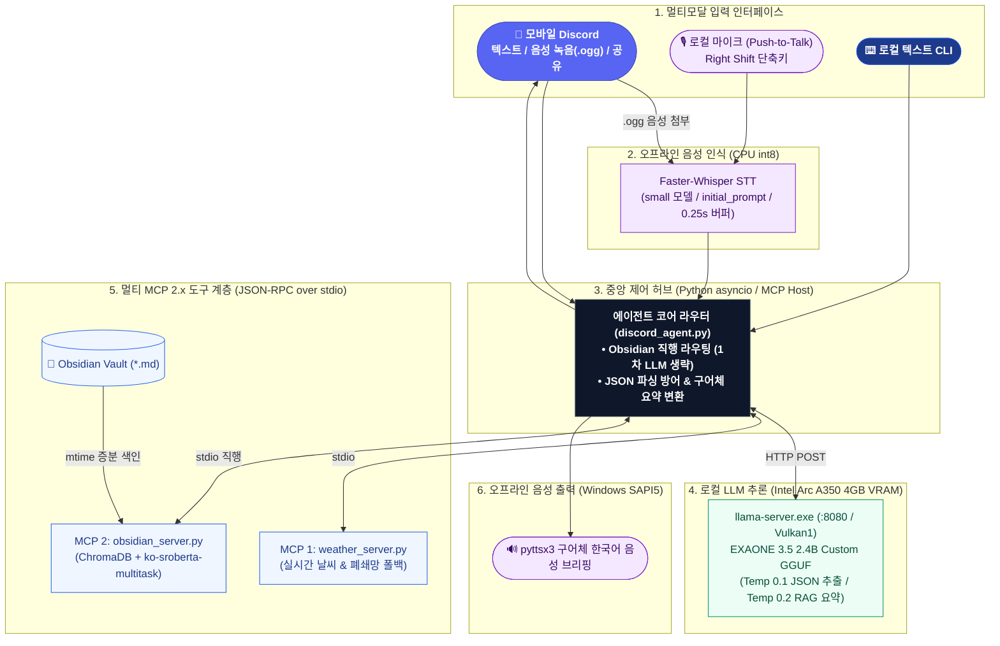

# 4GB VRAM 노트북에서 만든 로컬 AI 개인비서
- EXAONE 파인튜닝부터 MCP, 시맨틱 Vector RAG, 오프라인 음성, Discord 원격 제어까지

> **"고가의 클라우드 GPU나 유료 API 없이, 내 노트북의 보급형 GPU(Intel Arc A350, VRAM 4GB)만으로 한국어 LLM을 파인튜닝하고, 내 Obsidian 노트를 의미 기반으로 검색하며, 외출 중 스마트폰 Discord로 집 PC를 제어할 수 있을까?"**

상용 클라우드 AI 비서는 편리하지만 매월 발생하는 API 비용과 개인 일정·메모·노트·음성 데이터가 외부 서버로 전송된다는 프라이버시 한계가 있습니다. 이번 프로젝트(**`My-Muse-Exaone v1.0.2`**)에서는 **100% 로컬에서 구동되면서도 멀티 MCP(날씨 + Obsidian 시맨틱 Vector RAG), 오프라인 양방향 음성 입출력(STT/TTS), 그리고 Discord 원격 제어까지 결합된 온디바이스 AI 개인비서**를 처음부터 끝까지 직접 구축해 보았습니다.

---

## 1. 전체 시스템 아키텍처 (7-Layer End-to-End)

소형 언어모델(2.4B)이 엉뚱한 동작을 하거나 4GB VRAM 한계를 넘지 않도록, **두뇌(GPU 추론)**와 **손발(멀티 MCP 도구 및 CPU 임베딩/음성 처리)**, 그리고 **입출력 인터페이스(Discord/로컬 마이크)**를 계층별로 명확히 분리했습니다.

---

## 2. 핵심 구현 마일스톤

### ① 4GB VRAM 추론 최적화와 경량 LoRA 파인튜닝 (`0% → 100%`)
* **추론 엔진:** `llama.cpp`(Vulkan 백엔드)와 컨텍스트 최적화(`-c 2048 -ngl 99`)로 `LGAI-EXAONE/EXAONE-3.5-2.4B-Instruct` 모델을 구동해 **56.28 t/s** 프롬프트 처리 속도와 건당 **2.3~4.9초**의 응답 속도를 확보했습니다.
* **구조화 JSON 파인튜닝:** 6대 개인비서 기능(일정 등록 `CAL_ADD`, 할 일 추가 `TODO_INS`, 메일 요약 `MAIL_SUM`, 기기 제어 `SYS_CTRL`, 보안 거절 `SEC_DENY`, 날씨 조회 `WEATHER_GET`) 데이터셋을 생성하고 LoRA(`r=16`) 학습을 진행했습니다.
* **정량 검증 결과:** 학습에 쓰지 않은 미학습 질의(Unseen Queries)에 대해 파인튜닝 전 `0%`였던 커스텀 JSON 스키마 및 고유 서명(`[비서모드-v1]`) 준수율을 **`100%`**로 끌어올렸습니다.

### ② MCP 2.x 기반 Obsidian 시맨틱 Vector RAG (`obsidian_server.py`)
* **의미 유사도 검색:** 단순 키워드 매칭의 한계를 넘기 위해 `ChromaDB` 영구 저장소와 `jhgan/ko-sroberta-multitask` 로컬 한국어 임베딩 모델(Git Submodule 연동)을 결합했습니다. 덕분에 노트에 `"VRAM OOM 트러블슈팅"`이라고 적혀 있어도 *"그래픽카드 용량 모자랄 때 AI 모델 돌리는 법"*처럼 다른 단어로 질문해 의미 유사도(`%`) 기반으로 정확한 문단을 찾아냅니다.
* **4GB VRAM 보호 및 증분 색인:** 임베딩 연산은 `CPU`로 격리해 GPU 메모리를 보호하고, 파일 수정 시각(`mtime`)을 비교해 변경된 마크다운(`.md`) 파일만 고속 증분 업데이트합니다.
* **직행 라우팅 최적화:** `"옵시디언"` 키워드 감지 시 불필요한 1차 JSON 추출 단계(약 2.5초)를 생략하고 즉시 Vector DB 검색 및 2단계 요약으로 직행하도록 설계해 응답 속도를 2배 높였습니다.

### ③ 100% 오프라인 양방향 음성 비서 (`Faster-Whisper` + `pyttsx3`)
* **음성 인식(STT):** CPU `int8` 양자화 기반 `faster-whisper(small)` 모델에 한국어 도메인 어휘 힌트(`initial_prompt`)와 키 해제 후 `0.25초` 끝음절 보호 버퍼를 적용해 한국어 연음 인식률을 크게 개선했습니다.
* **음성 출력(TTS):** LLM의 기계용 JSON 원문 대신 `format_korean_summary()`가 자연스러운 구어체 한국어로 정제한 뒤, 인터넷 없이 동작하는 Windows 내장 SAPI5(`pyttsx3`)로 스피커 브리핑을 수행합니다.

### ④ Discord 원격 멀티모달 제어 및 24시간 저전력 상시 운영
* 공인 IP나 방화벽 포트 포워딩 없이 **Discord Gateway WebSocket**을 통해 외부 스마트폰 앱과 집 PC를 안전하게 연결했습니다.
* 외출 중 스마트폰 Discord 앱에서 **텍스트**를 보내거나 **마이크 버튼으로 음성 메시지(`.ogg`)를 녹음해 전송**하면, 집 PC에서 STT → LLM → MCP가 연쇄 작동하여 스마트폰 화면에는 **Embed 결과 카드**를, 집 PC 스피커로는 **음성 브리핑**을 동시에 전달합니다.
* Windows 전원 설정(`powercfg /change standby-timeout-ac 0` 및 덮개 닫기 시 `아무 것도 안 함`)을 적용해 노트북 상판을 닫고 화면 백라이트만 끈 최소 전력 상태로 24시간 안정 운영이 가능합니다.

---

## 3. 개발 과정에서 해결한 주요 트러블슈팅

* **`EXAONE 3.5`와 최신 `transformers` / `peft` 호환성 패치:** `create_causal_mask` 인자명 불일치(`input_embeds` vs `inputs_embeds`)를 `inspect.signature` 래퍼로 패치하고, `get_input_embeddings` 메서드를 동적 바인딩했습니다.
* **GGUF 변환 메타데이터 보정:** 병합된 `config.json`에 누락되기 쉬운 `layer_norm_eps`와 `rms_norm_eps`(`1e-5`) 키를 자동 보정하여 `convert_hf_to_gguf.py` 오류를 해결했습니다.
* **ChromaDB 2차원 리스트 인덱싱 및 `stdio` 로그 간섭 차단:** `collection.query()`가 반환하는 2차원 리스트 인덱싱 오류를 수정하고, MCP `stdio` 파이프 통신이 깨지지 않도록 `show_progress_bar=False`를 적용했습니다.
* **비동기 이벤트 루프 격리:** `discord.py`의 메인 이벤트 루프가 끊기지 않도록 무거운 STT 추론, LLM HTTP 호출, TTS 음성 재생을 모두 `asyncio.to_thread()` 워커 스레드로 분리했습니다.

---

## 4. 마치며 및 향후 계획

보급형 4GB VRAM 노트북 환경에서도 **양자화(`GGUF`) + 경량 파인튜닝(`LoRA`) + 표준 도구 프로토콜(`MCP 2.x`) + 로컬 Vector DB(`ChromaDB`) + 오프라인 음성/메신저 인터페이스**를 체계적으로 결합하면, 프라이버시 침해나 유지비 걱정 없는 나만의 풀스택 AI 비서를 구축할 수 있음을 확인했습니다.

* **다음 단계 확장 목표:**
  1. 학습 범위를 벗어난 일반 지식 질문(예: 영단어 뜻) 감지 시 일반 대화 모드로 전환하는 하이브리드 라우팅.
  2. 전용 Web GUI 대시보드와 멀티 MCP 실행기 직접 연동.
  3. 모바일 Discord 응답 카드 하단에 `[일정 확정]`, `[취소]` 터치 버튼을 제공하는 인터랙티브 UI(`discord.ui.View`) 추가.

---

## 5. 한 일 

1. Windows 환경에서 Intel Arc A350(VRAM 4GB) Vulkan 백엔드 기반 llama.cpp 로컬 추론 서버 구축
2. 표준 Windows Python 3.12 가상환경(.venv) 및 Intel Arc GPU(XPU) 지원 PyTorch·HuggingFace 학습 환경 구성
3. 한국어 특화 경량 언어모델(EXAONE-3.5-2.4B-Instruct) 기반 GGUF 다운로드 및 기본 대화형 CLI 클라이언트(test.py) 구현
4. 5대 개인비서 기능(일정, 할 일, 요약, 기기 제어, 보안 거절) 커스텀 JSON 스키마 설계 및 합성 학습 데이터셋 생성(make_dataset.py)
5. 로컬 LoRA 파인튜닝 스크립트(exaon_trainer.py) 개발 및 최신 transformers·peft·trl 호환성 몽키패치 적용
6. 파인튜닝 가중치 병합, config.json RMSNorm 메타데이터 보정 및 llama.cpp GGUF 포맷 양자화 변환
7. 서버 생명주기 자동 제어·이중 로깅 모듈(server_manager.py) 및 Before/After 정량 채점 파이프라인(pipeline.py) 구축
8. MCP(Model Context Protocol) 2.x 기반 날씨 조회 서버(weather_server.py) 및 개인비서 호스트(mcp_assistant.py) 구현
9. 날씨 조회(WEATHER_GET) 데이터 보강(200건) 및 로컬·Google Colab(T4 GPU) 고속 재학습·GGUF 재생성
10. Web UI 추론 파라미터(Temperature=0.1) 최적화 및 MCP 연동 통합 테스트 완료
11. 전체 기술 문서(README.md, INSTALL.md, USAGE.md, TEST_RESULT.md, TROUBLESHOOTING.md, MCP_GUIDE.md, COLAB_GUIDE.md, GIT_GUIDE.md) 및 블로그 포스팅 작성
12. Git Submodule + Sparse-Checkout 저장소 경량화 및 GitHub 원격 저장소 커밋·푸시
13. faster-whisper Git Submodule 등록 및 한국어 도메인 힌트(initial_prompt)·끝음절 보호(0.25s)·SAPI5(pyttsx3) 오프라인 음성 출력이 통합된 양방향 음성 비서(voice_poc.py) 구현
14. Discord 원격 연결 검증(discord_echo.py) 및 모바일·데스크톱 텍스트·음성 메시지(.ogg) 멀티모달 개인비서 에이전트(discord_agent.py) 구축
15. ChromaDB 영구 저장소와 jhgan/ko-sroberta-multitask 로컬 Git Submodule 임베딩 모델을 결합한 Obsidian Vault 시맨틱 Vector RAG MCP 서버(obsidian_server.py) 구현
16. Obsidian 키워드 감지 시 1차 LLM 추론을 생략하는 직행 라우팅 최적화 및 문맥 보존형 질의 정제(extract_obsidian_query) 적용
17. 노트북 덮개 닫힘 예외 및 유휴 절전 모드 해제(powercfg)를 통한 24시간 저전력 상시 운영 환경 구성
18. 전체 시스템 통신 명세서(ARCHITECTURE.md), 음성 구현 노트(VOICE_STT_GUIDE.md), 모바일·데스크톱 통합 테스트 시나리오(DISCORD_TEST_SCENARIO.md) 등 전체 문서 최신화
19. GitHub 원격 저장소 최종 푸시, 릴리즈 태그(v1.0.0 ~ v1.0.2) 발행 및 프로젝트 전체 완결 기술 블로그 포스팅 작성

---

## 6. 회고 및 향후 계획 (Next Step)

보급형 4GB VRAM GPU 환경에서도 **양자화(`GGUF`) + 경량 파인튜닝(`LoRA`) + 표준 도구 프로토콜(`MCP`)**을 결합하면 충분히 실용적인 로컬 AI 에이전트를 구축할 수 있음을 확인했습니다.

* **향후 할 일 (Roadmap):**
  - CLI 환경(`mcp_assistant.py`)에서 작동하는 **MCP 실행기(Host)를 웹 GUI 대시보드에 직접 연동**
  - 브라우저 채팅창에서도 자연어 명령으로 날씨 카드·일정 캘린더·할 일 목록이 실시간으로 동작하도록 고도화할 예정
