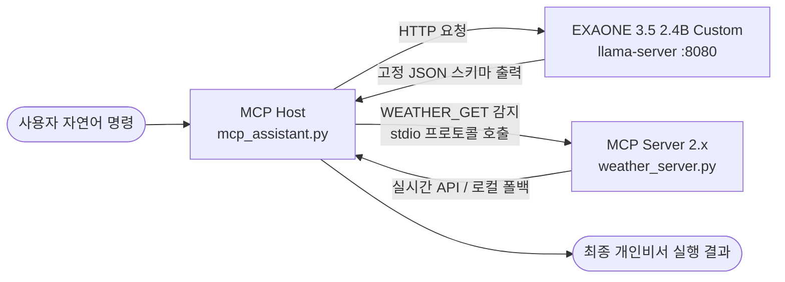

# VRAM 4GB 노트북에서 나만의 로컬 AI 비서 만들기: EXAONE 3.5 파인튜닝부터 MCP 연동까지

> **"비싼 클라우드 GPU 없이, 내 노트북의 보급형 GPU(Intel Arc A350, VRAM 4GB)만으로 한국어 LLM을 파인튜닝하고 실제 외부 도구(MCP)까지 제어할 수 있을까?"**

상용 LLM API는 똑똑하지만 매월 발생하는 비용과 개인 일정·메모 등 민감한 데이터가 외부 서버로 전송된다는 프라이버시 한계가 있습니다. 이번 프로젝트에서는 **외부 인터넷 의존 없이 내 PC에서 독립적으로 작동하는 온디바이스(On-Device) AI 비서(`My-Muse-Exaone`)**를 처음부터 끝까지 직접 구축해 보았습니다.

---

## 1. 프로젝트 목표 및 전체 아키텍처

단순히 챗봇과 수다를 떠는 수준을 넘어, **자연어 명령을 정확한 JSON 규격으로 변환하고 실제 외부 도구를 실행하는 에이전트**를 만드는 것이 목표였습니다.

### 핵심 파이프라인 설계
소형 모델(2.4B)이 엉뚱한 명령을 내리지 않도록 **두뇌(LLM)와 손발(MCP Host)의 역할을 철저히 분리**했습니다.



1. **의도 추론 계층 (`EXAONE 3.5 2.4B`):** 사용자의 말을 분석해 6가지 지정된 JSON 스키마(`CAL_ADD`, `TODO_INS`, `MAIL_SUM`, `SYS_CTRL`, `SEC_DENY`, `WEATHER_GET`)와 고유 서명(`[비서모드-v1]`)만 출력합니다.
2. **제어 및 도구 계층 (`MCP 2.x`):** 파이썬 제어기(Host)가 JSON을 파싱해, 날씨 조회(`WEATHER_GET`) 요청일 경우 공식 **MCP(Model Context Protocol) 2.x 서버**를 `stdio`로 호출하여 실제 날씨 정보를 가져옵니다.

---

## 2. 저사양 로컬 환경 구축 및 파인튜닝 도전기

### 하드웨어 및 실행 환경
* **GPU / OS:** Intel Arc A350 (VRAM 4GB) / Windows 11
* **베이스 모델:** `LGAI-EXAONE/EXAONE-3.5-2.4B-Instruct`
* **추론 엔진:** `llama.cpp` (Windows Vulkan 백엔드)

### 파인튜닝 전·후(Before vs After) 극적인 변화
모델이 정해진 JSON 스키마만 뱉도록 만들기 위해 6가지 핵심 비서 기능에 대한 합성 데이터셋(`200건`)을 생성하고 **LoRA 파인튜닝(`r=16`, Attention 4대 프로젝션 `q/k/v/o_proj`)**을 수행했습니다.

학습 데이터에 한 번도 등장하지 않은 **미학습 질의(Unseen Queries)**로 자동 채점 파이프라인(`pipeline.py`)을 돌린 결과는 놀라웠습니다.

| 평가 항목 | 파인튜닝 전 (Base 모델) | 파인튜닝 후 (Custom 모델) |
| :--- | :--- | :--- |
| **응답 형태** | 장황한 일반 한국어 줄글 설명 | **100% 문법 오류 없는 순수 JSON** |
| **고유 서명 태그(`[비서모드-v1]`)** | 미출력 / 불일치 | **100% 정확히 부착** |
| **미학습 단어 일반화** | 실패 | `"보일러 22도"` → `"temp": 22` 자동 추론 |
| **추론 속도 (Intel Arc Vulkan)** | - | **56.28 t/s (건당 평균 2.3~4.9초)** |

#### 실제 파인튜닝 모델 입출력 예시
* **입력:** `"서울시 중구 명동 날씨 어때?"`
* **출력:**
  ```json
  {"intent_code": "WEATHER_GET", "location": "서울시 중구 명동 날씨 어때"} [비서모드-v1]
  ```

---

## 3. MCP(Model Context Protocol) 2.x 날씨 도구 연동

모델이 뱉어낸 JSON을 실제 동작으로 연결하기 위해 최신 **MCP Python SDK v2.x**를 도입했습니다.

* **MCP Server (`weather_server.py`):** `MCPServer` 클래스와 `@mcp.tool()` 데코레이터를 사용해 지역명을 좌표로 변환하고 Open-Meteo 날씨 API를 비동기로 조회합니다. 사내망·방화벽 등으로 외부 API가 차단된 환경에서도 뻗지 않도록 **로컬 MCP 폴백(Fallback) 응답**까지 구현했습니다.
* **MCP Host (`mcp_assistant.py`):** 로컬 LLM으로부터 `WEATHER_GET` JSON을 전달받으면 `StdioServerParameters`를 통해 날씨 MCP 서버를 백그라운드 프로세스로 띄우고 결과를 받아 사용자에게 출력합니다.

---

## 4. 개발하며 겪은 핵심 트러블슈팅 3가지

이번 과제를 진행하면서 마주친 실전 문제들과 해결 노하우입니다.

1. **`EXAONE 3.5`와 최신 `transformers` / `peft` 호환성 충돌:**
   * `EXAONE 3.5`의 원격 모델 코드가 최신 `transformers`의 `create_causal_mask` 인자명(`input_embeds` vs `inputs_embeds`) 및 `get_input_embeddings` 메서드와 충돌했습니다. `inspect.signature` 기반 래퍼 패치와 `types.MethodType` 바인딩으로 해결했습니다.
2. **GGUF 변환 시 `exaone.attention.layer_norm_rms_epsilon` 누락 오류:**
   * 병합된 모델(`merged_model/config.json`)에 RMSNorm 엡실론 키가 명시되지 않아 `llama.cpp` 양자화 단계에서 오류가 발생했습니다. 변환 직전 `config.json`에 `layer_norm_eps`와 `rms_norm_eps`(`1e-5`)를 자동 보정하는 코드를 추가해 해결했습니다.
3. **Web UI 추론 시 첫 토큰 노이즈(`]`) 및 `Temperature` 민감도:**
   * 기본 Web UI(`Temperature = 0.8`)에서는 소형 모델이 확률이 낮은 토큰으로 튀면서 JSON 앞에 `]` 기호가 붙거나 의도 코드가 변형되었습니다. 추론 온도를 **`0.1`로 낮추어 결정론적(Deterministic) 생성을 유도**하자 100% 정확한 표준 스키마만 출력되었습니다.

---

## 5. 한 일 

1. Windows 환경에서 Intel Arc A350(VRAM 4GB) Vulkan 백엔드 기반 llama.cpp 로컬 추론 서버 구축
2. 표준 Windows Python 3.12 가상환경(.venv) 및 Intel Arc GPU(XPU) 지원 PyTorch·HuggingFace 학습 환경 구성
3. 한국어 특화 경량 언어모델(EXAONE-3.5-2.4B-Instruct) 기반 GGUF 다운로드 및 기본 대화형 CLI 클라이언트(test.py) 구현
4. 5대 개인비서 기능(일정, 할 일, 요약, 기기 제어, 보안 거절) 커스텀 JSON 스키마 설계 및 합성 학습 데이터셋 생성(make_dataset.py)
5. 로컬 LoRA 파인튜닝 스크립트(exaon_trainer.py) 개발 및 최신 transformers·peft·trl 호환성 몽키패치 적용
6. 파인튜닝 가중치 병합, config.json RMSNorm 메타데이터 보정 및 llama.cpp GGUF 포맷 양자화 변환
7. 서버 생명주기 자동 제어·이중 로깅 모듈(server_manager.py) 및 Before/After 정량 채점 파이프라인(pipeline.py) 구축
8. MCP(Model Context Protocol) 2.x 기반 날씨 조회 서버(weather_server.py) 및 개인비서 호스트(mcp_assistant.py) 구현
9. 날씨 조회(WEATHER_GET) 데이터 보강(200건) 및 로컬·Google Colab(T4 GPU) 고속 재학습·GGUF 재생성
10. Web UI 추론 파라미터(Temperature=0.1) 최적화 및 MCP 연동 통합 테스트 완료
11. 전체 기술 문서(README.md, INSTALL.md, USAGE.md, TEST_RESULT.md, TROUBLESHOOTING.md, MCP_GUIDE.md, COLAB_GUIDE.md, GIT_GUIDE.md) 및 블로그 포스팅 작성
12. Git Submodule + Sparse-Checkout 저장소 경량화 및 GitHub 원격 저장소 커밋·푸시

---

## 6. 회고 및 향후 계획 (Next Step)

보급형 4GB VRAM GPU 환경에서도 **양자화(`GGUF`) + 경량 파인튜닝(`LoRA`) + 표준 도구 프로토콜(`MCP`)**을 결합하면 충분히 실용적인 로컬 AI 에이전트를 구축할 수 있음을 확인했습니다.

* **향후 할 일 (Roadmap):**
  - CLI 환경(`mcp_assistant.py`)에서 작동하는 **MCP 실행기(Host)를 웹 GUI 대시보드에 직접 연동**
  - 브라우저 채팅창에서도 자연어 명령으로 날씨 카드·일정 캘린더·할 일 목록이 실시간으로 동작하도록 고도화할 예정
